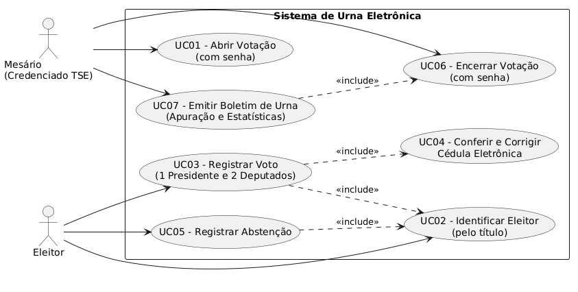
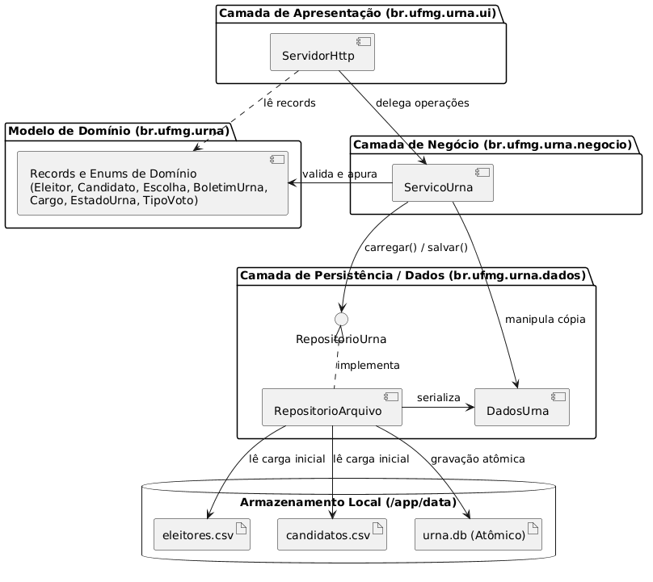
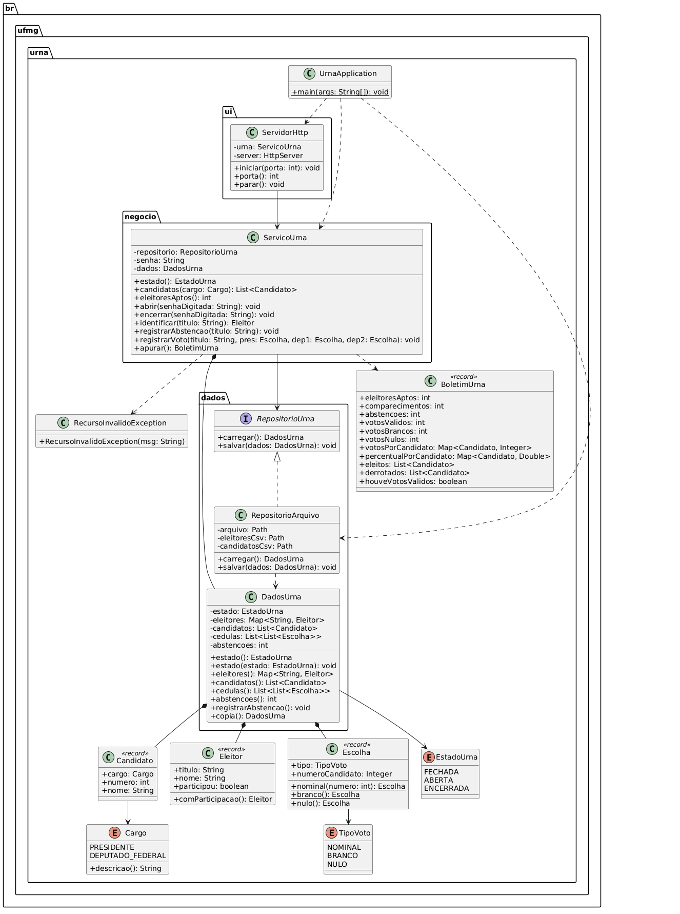
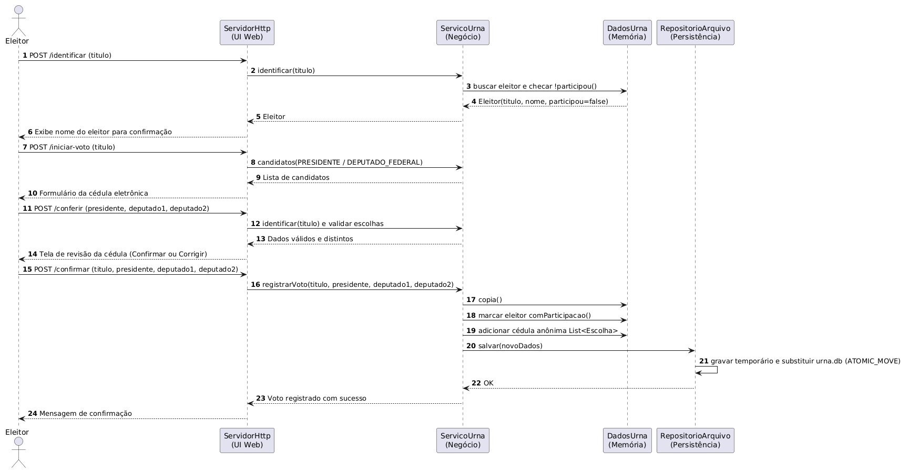
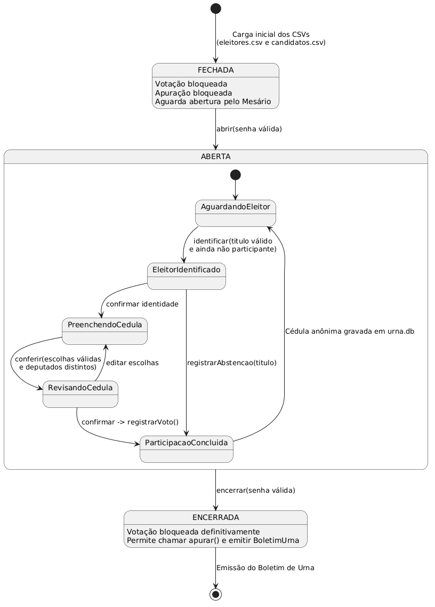

# Documentação do Projeto — Sistema de Urna Eletrônica (Grupo 2)

Esta pasta reúne tanto os **documentos oficiais de especificação do Trabalho Prático (DCC603 — Engenharia de Software I — Prof. Eduardo Figueiredo)** quanto os **artefatos de engenharia de software das Sprints 1, 2 e 3** (em formato PDF, Markdown e PlantUML/PNG), integralmente sincronizados com a implementação em Java 17 e com a suíte de testes JUnit 5.

---

## 1. Documentos Entregáveis do Grupo 2 (PDF)

- 📄 [**Documentacao_Completa_TP_Urna_Eletronica.pdf**](./Documentacao_Completa_TP_Urna_Eletronica.pdf) — Documento consolidado final (Sprints 1, 2 e 3: Processo Scrum, Cronograma, Requisitos, Casos de Uso e Cenários, Arquitetura em Camadas, Diagramas UML, Implementação Java 17, Testes JUnit 5, Matriz de Rastreabilidade e Declaração de Uso de IA).
- 📄 [**Sprint1_Planejamento_e_Requisitos.pdf**](./Sprint1_Planejamento_e_Requisitos.pdf) — Entrega da Sprint 1 (Modelo de Processo Scrum, Papéis, Cronograma, Requisitos Funcionais `RF01`–`RF13`, Requisitos Não Funcionais `RNF01`–`RNF06` e Product Backlog MoSCoW).
- 📄 [**Sprint2_CasosDeUso_Arquitetura_Modelagem.pdf**](./Sprint2_CasosDeUso_Arquitetura_Modelagem.pdf) — Entrega da Sprint 2 (Diagrama de Casos de Uso, Cenários `UC01`–`UC07`, Projeto Arquitetural com Diagrama de Componentes e Projeto Detalhado com Diagramas de Classes, Sequência e Máquina de Estados).

---

## 2. Especificação Oficial da Disciplina (`docs/especificacao/`)

Arquivos extraídos do repositório da disciplina ([`Lealwbs/engsoft`](https://github.com/Lealwbs/engsoft/tree/main/trabalho_pratico)):

- 📘 [**tp-instrucao.pdf**](./especificacao/tp-instrucao.pdf) — Instruções gerais para o Trabalho Prático (regras das Sprints 1, 2 e 3, entregas em PDF + GitHub e diretrizes sobre uso de IA).
- 📘 [**tp-temas.pdf**](./especificacao/tp-temas.pdf) — Lista de temas do TP (**Tema 2: Sistema de urna eletrônica**).
- 📘 [**tp-slides.pdf**](./especificacao/tp-slides.pdf) — Slides de apresentação do TP (diretrizes, distribuição dos 20 pontos e cronograma de entregas).
- 📘 [**tp-alocacao.pdf**](./especificacao/tp-alocacao.pdf) — Alocação de grupos e ordem de apresentação (**Grupo 2: Urna Eletrônica** — Davi Ladeira Balsamão, Ítalo Leal Lana Santos, Thiago Amorim Bastos e Vitor Hugo Dias Santos).

---

## 3. Diagramas UML (`docs/diagramas/`)

Todos os diagramas possuem código-fonte versionado em PlantUML (`.puml`) e imagem renderizada (`.png`):

### 3.1. Diagrama de Casos de Uso (`casos_de_uso.puml`)

### 3.2. Diagrama de Componentes e Arquitetura em Camadas (`componentes.puml`)

### 3.3. Diagrama de Classes Detalhado (`classes.puml`)

### 3.4. Diagrama de Sequência — Fluxo de Votação (`sequencia_votacao.puml`)

### 3.5. Diagrama de Máquina de Estados da Urna (`estados_urna.puml`)

